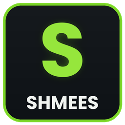

<p align="center"></p>

<h1 align="center">Mod Menu Manager</h1>

<p align="center">
Install and remove Call of Duty mod menus on the Xbox 360 from the controller.<br>
An Aurora utility script by <b>Shmees</b>.
</p>

<p align="center">


</p>

---

## Status

**Preview build (v0.1).** The install, backup, restore and rollback logic is tested off-console against a simulated Aurora. It has not been run on hardware yet, so keep the console offline and report anything odd.

## Features

- **Finds your games.** Scans every drive for Call of Duty: extracted game folders and Games on Demand installs. Folders that aren't found automatically can be added by hand.
- **A menu library per game.** Menus live in `Menus\<GAME>\` beside the script, each with a short `menu.ini` describing it.
- **Two kinds of menu.**
  - *File menus*: patch `.ff` files, GSC scripts and other files copied into an extracted game folder.
  - *Plugin menus*: a `.xex` plugin placed in a free DashLaunch plugin slot.
- **Backups of everything.** Every file it replaces, and every `launch.ini` line it changes, is saved first. **Installed menus** puts it all back with one press.
- **Automatic rollback.** If a copy fails partway through, everything already changed is put back.
- **Launch from the script.** Boots the game straight after installing, through Xbdm, the same way Dev Map Launcher does.
- **Logged.** Every install, removal and launch is written to `manager.log`.

## Supported games

| Folder in `Menus` | Game | Title ID |
| --- | --- | --- |
| `COD4` | Call of Duty 4: Modern Warfare | 415607E6 |
| `WAW` | Call of Duty: World at War | 4156081C |
| `MW2` | Modern Warfare 2 | 41560817 |
| `BO1` | Black Ops | 41560855 |
| `MW3` | Modern Warfare 3 | 415608CB |
| `BO2` | Black Ops II | 415608C3 |
| `GHOSTS` | Ghosts | 415608FC |
| `AW` | Advanced Warfare | 41560914 |
| `BO3` | Black Ops III | 4156091D |
| `ALL` | Plugin menus that work in every game | |

## Requirements

- A homebrew-capable Xbox 360 running **Aurora**.
- For **plugin menus**: DashLaunch, with `launch.ini` in the root of a drive.
- For **Launch a game**: the `xbdm.xex` plugin loaded (port 730), as for Dev Map Launcher.
- For **file menus**: the game extracted to a folder (XEX format). Games on Demand installs can only use plugin menus.

Mod menus themselves are not included. Use menus you trust, from their original authors.

## Install

1. Download `ModMenuManager-v0.1.zip` and unzip it.
2. Copy the `ModMenuManager` folder to `Aurora\User\Scripts\Utility\` on your console (FTP works well).
3. Restart Aurora, then open **Utilities > Scripts > Mod Menu Manager**.

On first run the script creates a folder for each game inside `Menus`.

## Adding menus

Each menu gets its own folder:

```
ModMenuManager\
  Menus\
    MW2\
      My Patch Menu\
        menu.ini
        files\
          patch_mp.ff                      <- copied to the game folder
          maps\mp\gametypes\_clientids.gsc <- folders are created as needed
    ALL\
      My Plugin Menu\
        menu.ini
        MyMenu.xex
```

- **File menus:** put the files in `files\`, laid out exactly as they go in the game folder.
- **Plugin menus:** put the `.xex` next to `menu.ini`.
- Folders starting with `_` are ignored. Ready-to-copy examples are in `Menus\_Templates`.

### menu.ini

```ini
name        = My Patch Menu
version     = 1.0
author      = Original author's name
type        = files            ; files or plugin
description = One or two lines shown before installing.
mode        = Multiplayer      ; optional
launch      = default_mp.xex   ; optional, file menus: what "Launch now" boots
plugin      = MyMenu.xex       ; plugin menus: the plugin file
note        = Turn off title updates in Aurora if the menu doesn't load.   ; optional
```

Only `type` is really needed. Without `name`, the folder name is used.

## Using it

| Screen | What it does |
| --- | --- |
| **Install a mod menu** | Pick a game, pick a menu, confirm. File menus ask which copy of the game if you have more than one. Plugin menus ask which plugin slot to use. |
| **Installed menus** | Everything installed, with when and where. Select one to remove it and restore the originals, or to launch the game. |
| **Game library** | Every copy of each game that was found. Scan again, add a folder by hand, or launch from here. |
| **Launch a game** | Boot any extracted copy straight from the script. |
| **Help** | Short guides on the console itself. |

Only one file menu can be installed in a game folder at a time. Installing another offers to swap them, restoring the originals in between.

## How it works

- **File menus** back up each original into `Backups\<game folder>\`, write a record to `installed.txt`, then copy the menu in. Removing it copies the originals back, deletes files the menu added, and removes any folders it created.
- **Plugin menus** copy the `.xex` to `Plugins\ModMenus\` on the drive that holds `launch.ini`, save `launch.ini` to `Backups\launch.ini.last`, then set the chosen `pluginN` line. The drive style (`Usb:\`, `Hdd:\`) is copied from the plugins already listed. Removing it sets the line back to what it was. If something else has changed that line since (for example **Profile Switcher**), the line is left alone.
- **Launching** sends an Xbdm `magicboot` command to port 730 through Aurora's `Http.Get`, exactly like Dev Map Launcher.

## Settings

The tables at the top of `main.lua` can be edited:

| Setting | Default | Purpose |
| --- | --- | --- |
| `GameParents` | `Games`, `XBOX360`, `Xbox 360\Games` | Folders searched for extracted games on every drive |
| `XbdmDriveNames` | `Hdd1 = HDD` ... | How Xbdm names each drive for launching. Keep it matching Dev Map Launcher. |
| `PluginFolder` | `Plugins\ModMenus` | Where plugin menus are copied |
| `DashLaunchDevices` | `Hdd1 = Hdd:`, `Usb0 = Usb:` ... | Fallback drive names for `launch.ini` |
| `PluginSlots` | `5` | Number of DashLaunch plugin slots |

## Limitations

- File menus need an extracted game. Games on Demand containers can't be edited.
- An active title update can load its own patch files over a file menu. If a menu doesn't show up, turn off title updates for that game in Aurora.
- Plugin menus load at boot: power the console fully off and on after installing or removing one.
- Switching profiles with Profile Switcher rewrites `launch.ini`, so install plugin menus again afterwards.

## Staying safe

- Use mod menus **offline, in private matches or on system link**.
- Keep `liveblock` enabled in `launch.ini` and stay off Xbox Live while running modified software.
- Everything the script changes can be undone from **Installed menus**. Backups live in the script's `Backups` folder.

## Tests

`tests/` runs the script against a simulated Aurora (fake drives, popups and button presses) and checks every install, swap, removal, rollback and plugin-slot change. It needs `texlua`, which ships with TeX Live:

```
texlua tests/run_tests.lua ModMenuManager
```

## Credits and license

Written by **Shmees**. Released under the [MIT License](LICENSE): use it, change it and share it.

- YouTube: [@Shmees14](https://www.youtube.com/@Shmees14)
- GitHub: [ShmeeMcgee](https://github.com/ShmeeMcgee)

Also by Shmees: [Dev Map Launcher](https://github.com/ShmeeMcgee/DevMapLauncher) · [Profile Switcher](https://github.com/ShmeeMcgee/ProfileSwitcher) · [Shmees Media Center](https://github.com/ShmeeMcgee/ShmeesMediaCenter)

*Not affiliated with Microsoft or Activision. Xbox 360 and Call of Duty are trademarks of their respective owners.*
